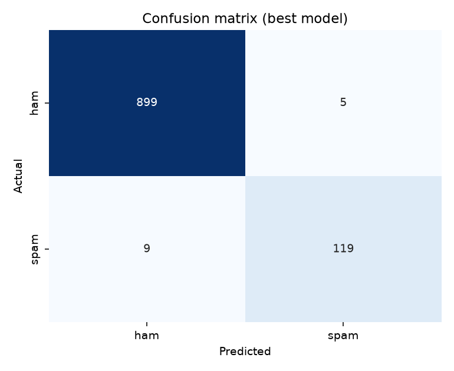
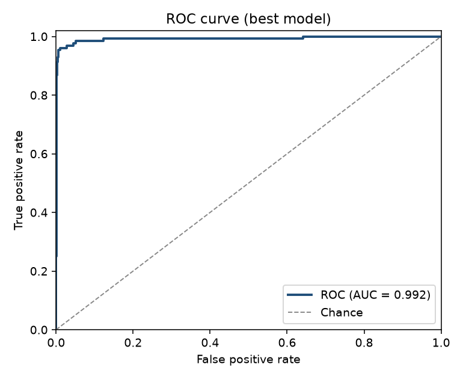

# Spam Email / SMS Detection

[](https://huggingface.co/spaces/waleedarif1011/spamemaildetection)
[](https://github.com/waleedarif1011/spamemaildetection/actions/workflows/ci.yml)
[](LICENSE)

Classic SMS/email spam classifier with a **multi-model benchmark**, exported evaluation plots, a saved scikit-learn pipeline, and a one-click Gradio detector that highlights spam-trigger tokens.

> **Live demo:** after the Hugging Face Space is created (see [Deploy](#deploy-hugging-face-space)), open the badge URL above. Until then, run locally with `python app.py`.

## Results (held-out 20%, stratified)

| Model | Accuracy | Precision | Recall | F1 | ROC-AUC |
|-------|----------|-----------|--------|----|---------|
| CountVectorizer + MultinomialNB | 0.985 | 0.959 | 0.922 | 0.940 | 0.986 |
| TF-IDF + Logistic Regression | 0.984 | 0.924 | 0.945 | 0.934 | 0.992 |
| **TF-IDF + LinearSVC (calibrated)** | **0.986** | **0.960** | **0.930** | **0.944** | **0.992** |

Best model by F1: `tfidf_linearsvc`. Full numbers: [`artifacts/metrics.json`](artifacts/metrics.json).

### Confusion matrix & ROC





## Quickstart

```bash
python -m pip install -r requirements.txt
python -m src.train          # train + write artifacts/ and assets/
python app.py                # Gradio demo at http://127.0.0.1:7860
```

### CLI inference

```bash
python -m src.predict "Congratulations! You WON a free prize. Call now."
python -m src.predict "Can we move our standup to 10am?"
```

Returns JSON with `label`, `spam_probability`, and `top_tokens`.

## Method (short)

- **Data:** UCI SMS Spam Collection (`data/spam.csv`, latin-1), cleaned labels/text, deduped (~5.2k messages, ~12% spam).
- **Split:** 80/20 stratified train/test (`random_state=42`).
- **Models:** Count + MultinomialNB; TF-IDF + LogisticRegression; TF-IDF + Calibrated LinearSVC.
- **Export:** best pipeline → `artifacts/spam_pipeline.joblib`; metrics → `artifacts/metrics.json`; plots → `assets/`.
- **Explainability:** per-message tokens ranked by vectorizer weight × classifier coefficient (or NB log-odds).

## Tests & CI

```bash
python -m pytest -q
```

GitHub Actions runs the same suite on every push/PR (`.github/workflows/ci.yml`).

## Deploy (Hugging Face Space)

This repo is Space-ready (`app.py` + Gradio README frontmatter). Create and push:

```bash
# once: huggingface-cli login   # needs a write token with Spaces scope
huggingface-cli repo create spamemaildetection --type space --space_sdk gradio -y
git remote add space https://huggingface.co/spaces/waleedarif1011/spamemaildetection
git push space HEAD:main
```

Step-by-step: [`docs/hf-space-deploy.md`](docs/hf-space-deploy.md).

## Layout

```
app.py           Gradio spam detector (4 presets)
src/train.py     multi-model train + metrics/plots
src/predict.py   CLI + token contributions
data/spam.csv    SMS spam dataset
artifacts/       pipeline + metrics.json
assets/          confusion matrix + ROC plots
notebooks/       original exploratory notebook
tests/           pytest smoke tests
```

## License

MIT — see [`LICENSE`](LICENSE).
